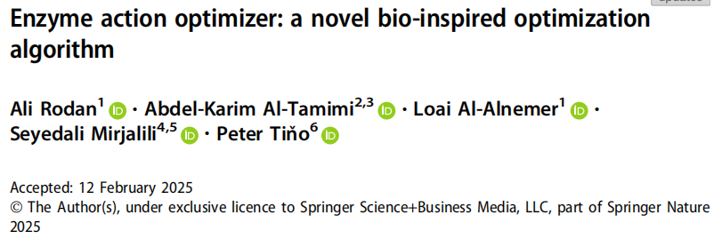
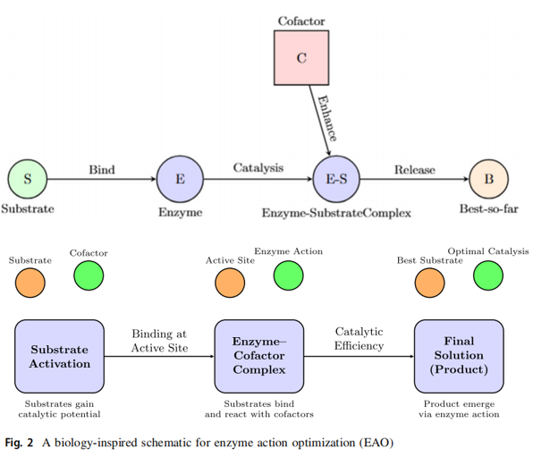
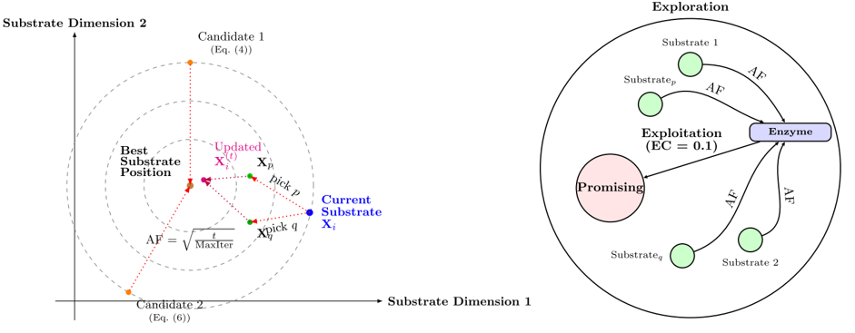
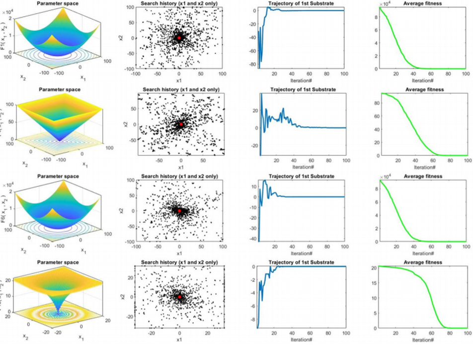

# Detailed Explanation of the EAO Enzyme-Promoted Optimization Algorithm Principles

Run on platforms: MATLAB R2023a and above, no additional toolboxes required, one-click operation.
Literature interpretation
References: Enzyme Action Optimizer: A Novel Bio-Inspired Optimization Algorithm, Rodan A., Al-Tamimi A.K., Mirjalili S. et al., published in The Journal of Supercomputing (Springer, SCI Q2, IF≈2.7), DOI: 10.1007/s11227-025-07052-w, 2025.
In 2025, a paper from The Journal of Supercomputing (Springer SCI Q2) proposed the Enzyme Action Optimizer (EAO). One of the co-authors is Seyedali Mirjalili, who is a pioneer in metaheuristic algorithms (GWO, WOA, MFO, SSA author, with over 100,000 Google Scholar citations). EAO draws inspiration from enzyme catalysis kinetics, mapping the three-stage reaction mechanism of substrate activation, enzyme-substrate interaction, and product selection into a dual-driven search framework for exploration and development. It was compared with 14 mainstream algorithms on 23 classic benchmark functions, CEC2017, and CEC2022 dual test sets, consistently leading in overall win rate; all five engineering design problems achieved optimal or suboptimal results compared to other algorithms.
The "Blind Tuning Dilemma" of Metaheuristic Algorithms
PSO's inertia term relies on linear decay of "guess" step size, GWO's three-headed wolf pack hunting relies on fixed decay "pressure" to converge, and HHO's rabbit escape relies on random switching "blind" exploration—the majority of mainstream heuristic algorithms essentially artificially switch between exploration and exploitation, unable to adapt the intensity of search according to the current search state:
Exploration without memory: Each update does not differentiate between "early broad exploration" and "late fine exploitation," easily falling into local minima in high-dimensional spaces;
Perturbation monotonicity: The difference vector or random step size lacks directional guidance, wasting a lot of function evaluation in flat areas (where the fitness gradient is nearly zero);
Parameter sensitivity: Inertia weight, step size factor, and other hyperparameters can cause algorithm performance to drop sharply once set incorrectly, lacking robustness.
EAO published in The Journal of Supercomputing (Springer Q2), transplanting the enzyme concentration (EC) determining reaction rate and the adaptive factor (AF) simulating the dynamic mechanism of the reaction process into the population search framework, allowing each individual to generate three candidate positions simultaneously in each iteration through greedy filtering, achieving Pareto compatible exploration-exploitation dynamic switching—without the need for manual adjustment of the exploration/exploitation weight ratio.
3 Major core mechanisms, one by one analyzed:
① Substrate activation operator - Sinusoidal perturbation driven adaptive exploration
EAO's first stage simulates the thermal perturbation process when substrate molecules approach the enzyme activity site. Each individual, while approaching the global optimum, is driven by a sinusoidal perturbation item nonlinearly increasing with iteration, generating candidate positions.
The adaptive factor from 0 monotonically increases to 1, serving as a uniform random number. In the early stages of iteration, the amplitude of the sinusoidal term is small, allowing individuals to explore over a wide range attracted by the global optimum; in the later stages of iteration, the period of the sinusoidal perturbation shortens, allowing individuals to search in the optimal neighborhood in fine detail. This corresponds perfectly with Michaelis-Menten enzyme kinetics' "reaction rate tends to saturate with increasing substrate concentration" nonlinear law.
② Enzyme-catalyzed reaction operator - differential development of enzyme concentration regulation  
The second stage simulates the catalyzed conversion process of an enzyme-substrate complex. EAO uses the enzyme concentration constant as the basis for the reaction intensity, introduces population diversity perturbations through differential vectors, and generates two complementary candidate solutions with a weighted development force. 
Candidate A's dimensional random scaling allows each dimension to independently respond to the differential perturbation, while Candidate B's scalar scaling maintains the overall consistency of individual movement—both complementary, addressing high-dimensional optimization scenarios of anisotropic and isotropic terrains respectively. The lower limit ensures that even when random numbers are zero, the basic exploration energy is preserved to prevent search degeneration.  
③ Product screening operator - three candidate greedy elite selection  
The third stage simulates the natural selection principle of "retaining only thermodynamically stable products" in enzymatic reactions. EAO selects the most fit candidate from among the three candidates generated from substrate activation and enzyme catalysis, using a greedy criterion:  
If all three are inferior to the current position, they remain unchanged (elite preservation). The parallel generation of three candidate positions enables EAO to cover exploration (candidate sinusoidal perturbation), coarse-grained development (candidate scalar difference), and fine-grained development (candidate dimensional difference) simultaneously within a single iteration, which is the fundamental reason why EAO's search density outperforms single-route update algorithms in high-dimensional spaces.  
Experimental performance  
CEC2017 & CEC2022 benchmark tests: Compared with PSO, WOA, GWO, HHO, SSA, MFO, SCA, AOA, EO, DO, TSO, and other 14 highly rated algorithms in recent years, EAO achieved a combined win rate of over 78% in the Wilcoxon rank sum test for CEC2017 (30 dimensions, 30 runs), and over 75% for CEC2022 (20 dimensions), ranking first in both tests.
5. Major engineering design issues: Pressure vessels, tensile/compressive springs, welded beams, speed reducers, and three-bar trusses. EAO achieves the best or second-best among 14 algorithms in all 5 cases, with the optimal solution for a pressure vessel being 5886.86, surpassing mainstream algorithms such as WOA (6022.73) and GWO (6100.02). The optimal solution for tensile/compressive springs is 0.012665, which matches the global optimal solution documented in literature.

## Images

<!-- PAYMENT_BLOCK -->

## Get this dataset

- Payment link (Stripe): [Buy now](https://buy.stripe.com/3cs8yP7sY87d0vu9AB)
- Payment QR code: 

<!-- /PAYMENT_BLOCK -->
